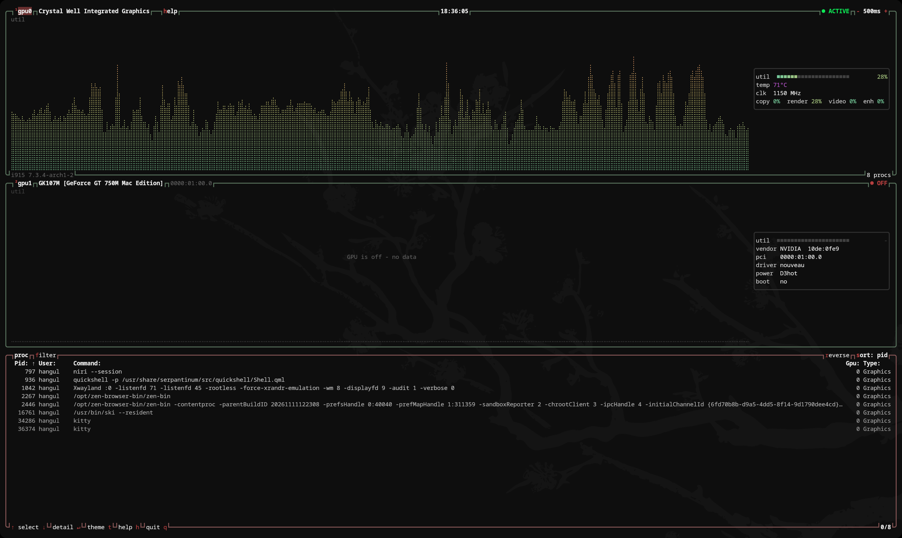

# gputop

See every GPU in your machine and whether it's on or off. A btop-style terminal
monitor for Linux.



## Features

- Every GPU in the machine is listed, found by PCI discovery, including GPUs that
  are off, suspended, have no driver or use a driver gputop can't read.
- A sleeping GPU is never woken up. Its status comes from cheap PCI attributes,
  and no backend touches it until it is awake.
- Looks and feels like btop. btop `.theme` files load as-is.
- Overview of all GPUs, a detail view for one GPU, and a process list.
- Live stats: utilization, VRAM, power, temperature, clocks, PCIe, throttle
  reasons and per-process usage, where the GPU and driver report them.
- Keyboard and mouse control.

## Backends

| Backend | Source | State |
| --- | --- | --- |
| NVIDIA | NVML (`nvidia-ml-py`) | Implemented. Tested against a simulated NVML, not yet on real hardware. |
| Intel | sysfs, i915 perf PMU with an RC6 fallback, RAPL | Implemented and tested on real hardware. |
| AMD | - | Stub. AMD GPUs are listed by PCI discovery, without live stats. |

`--backend auto` is the default. It uses every backend that can start and skips
the others.

## Install

Requires Python 3.11+ and Linux.

```sh
pipx install git+https://github.com/cookiefree/gputop
# or, from a clone:
pipx install .
```

NVIDIA stats need NVIDIA's proprietary driver, which provides NVML. GPUs on
nouveau are listed but get no live stats.

## Usage

```sh
gputop                              # start the monitor
gputop --list                       # print every GPU with its status
gputop --once                       # print one snapshot as JSON
gputop --backend intel              # force a backend (error if it can't start)
gputop --backend fake --fake-gpus 3 # synthetic GPUs, no hardware needed
gputop --interval 1000 --theme nord # refresh every second, nord theme
```

Run `gputop --help` for all options.

## Keys

| Key | Action |
| --- | --- |
| `q`, `Esc` | Quit |
| `Tab`, `Shift+Tab`, `1`-`9` | Focus a GPU |
| `a`, `Enter` | Toggle overview / detail view |
| `↑` `↓` `PgUp` `PgDn` `Home` `End` | Select a process |
| `s`, `r` | Cycle sort column, reverse sort |
| `f`, `/` | Filter processes (`Enter` keeps, `Esc` clears) |
| `+`, `-` | Refresh faster / slower (100 ms to 5 s) |
| `t` | Cycle theme |
| `Shift+R` | Re-run GPU discovery (also `kill -USR1 <pid>`) |
| `h`, `?` | Help |

Mouse: click a GPU box to focus it, double-click for the detail view, click a
column header to sort, scroll the process list with the wheel.

## Statuses

| Status | Meaning |
| --- | --- |
| ACTIVE | Driver bound, GPU awake, live stats available. |
| SUSPENDED | Driver bound, GPU runtime-suspended (D3hot/D3cold). Not queried. |
| OFF | Powered off or disabled (`enable=0`, D3cold without a driver, vga_switcheroo off). |
| NO DRIVER | Present, but no kernel driver is bound. |
| UNSUPPORTED | Awake, but on a driver gputop can't read (nouveau, vfio-pci), or its backend failed. |

## Intel notes

- Utilization is estimated from RC6 residency, which needs no permission. It is
  shown as `util~`.
- For exact per-engine numbers, run `sudo sysctl kernel.perf_event_paranoid=0`.
  Add the setting to a file in `/etc/sysctl.d/` to make it permanent.
- Power needs read access to RAPL, which is usually root-only. Without it, power
  is hidden.

## More

Configuration, themes, architecture, development and performance:
[docs/DETAILS.md](docs/DETAILS.md).

## License

See [LICENSE](LICENSE).
