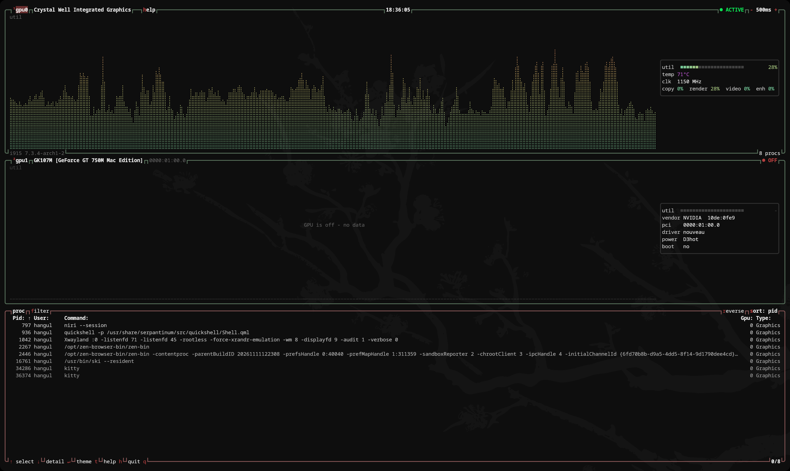

# gputop: details

Full documentation: configuration, themes, architecture, development and performance.

A **btop-style multi-GPU terminal monitor** for Linux. Think "btop, but the
whole screen is GPU stats". It is drawn the way btop draws (checked against a
capture of btop 1.4.8): tiled boxes with titles in the border (`┐¹gpu0┌`),
btop's Default colours, braille area graphs with vertical gradients, `■`
meters, a sortable process box, mouse support and btop-format themes. It
handles any number of GPUs at once.



*A real laptop: the Intel iGPU is `● ACTIVE` with live stats and processes;
the NVIDIA GT 750M (on nouveau, switched off) is still listed, as `● OFF`.*

With `--backend fake --fake-gpus 2` (synthetic data, no GPU needed):

```
╭─┐¹gpu0┌┐RTX 4090┌──┐help┌─────────┐13:48:11┌─────────────────────┐- 500ms +┌─╮
│ util           ⣴⣶⣶⣶⣶⣶⣦⣴⣶⣶⣶⣤⣴⣶⣶⣴⣶⣶⣴⣦⣦ │vram  ■■■■■■■■■■■■■■■■■■■■■ 11.0/24.0G │
│                ⣿⣿⣿⣿⣿⣿⣿⣿⣿⣿⣿⣿⣿⣿⣿⣿⣿⣿⣿⣿⣿ │util  ■■■■■■■■■■■■■■■■■■■■■        90% │
│                ⣿⣿⣿⣿⣿⣿⣿⣿⣿⣿⣿⣿⣿⣿⣿⣿⣿⣿⣿⣿⣿ │power ■■■■■■■■■■■■■■■■■■■■■   400/450W │
│             ⣤⣤⣦⣿⣿⣿⣿⣿⣿⣿⣿⣿⣿⣿⣿⣿⣿⣿⣿⣿⣿⣿⣿⣿ │temp 78°C  mem 86°C  fan 60%           │
│ power          ⣶⣶⣶⣿⣷⣶⣷⣾⣶⣾⣶⣶⣾⣷⣶⣶⣶⣶⣶⣶⣶ │clk  2790 MHz  mem 10501 MHz           │
│             ⣠⣤⣤⣿⣿⣿⣿⣿⣿⣿⣿⣿⣿⣿⣿⣿⣿⣿⣿⣿⣿⣿⣿⣿ │pcie  ▼42.1MB/s  ▲502MB/s  Gen4x16     │
╰┘nvidia 555.42.02└───────────────────────────────────────────────────┘3 procs└╯
╭─┐²gpu1┌┐RTX 3060┌────────────────────────────────────────────────────────────╮
│ util        ⣠⣤⣦⣤⣀⡀⡀                  │vram  ■■■■■■■■■■■■■■■■■■■■■  3.7/12.0G │
│             ⣿⣿⣿⣿⣿⣿⣿                  │util  ■■■■■■■■■■■■■■■■■■■■■         4% │
│             ⣿⣿⣿⣿⣿⣿⣿                  │power ■■■■■■■■■■■■■■■■■■■■■    17/170W │
│             ⣿⣿⣿⣿⣿⣿⣿⣀⣠⣀⣦⣶⣆⣄⣀⣀⣀⣀⣀⣠⣤⣤⣄⣀ │temp 35°C  mem 43°C  fan 0%            │
│ power       ⣴⣶⣶⣶⣦⣤⣦                  │clk  295 MHz  mem 7501 MHz             │
│             ⣿⣿⣿⣿⣿⣿⣿⣀⣀⣀⣄⣤⣄⣀⣀⣀⣀⣀⣀⣠⣠⣤⣄⣀ │pcie  ▼5.9MB/s  ▲21.3MB/s  Gen4x16     │
╰┘nvidia 555.42.02└─────────────────────────────────────────────┘idle└┘2 procs└╯
╭─┐proc┌┐filter┌─────────────────────────────────────────┐reverse┌┐sort: vram┌─╮
│    Pid: User:     Command:                      Gpu:   Vram ↓   Sm% Type:    │
│    5962 nik       /home/user/.steam/ubuntu12_3…    0     4.7G    37 Graphics │
│    6722 root      /usr/lib/firefox/firefox -co…    0     3.8G    27 Graphics │
│    6173 nik       /usr/bin/kwin_wayland --wayl…    1     2.5G     2 Graphics │
│    4021 alice     /usr/lib/firefox/firefox -co…    0     2.2G    62 Graphics │
│    4850 ci-runner python train.py --model llam…    1   972.5M     3 Compute  │
╰┘↑ select ↓└┘detail ↵└┘theme t└┘help h└┘quit q└──────────────────────────┘0/5└╯
```

## Features

- **All-GPUs overview**: one box per GPU (like btop's cpu box): util and power
  graphs on the left, a stats panel on the right. Boxes tile the screen with no
  gaps; 1-2 GPUs take ~65 % of the height, 3+ GPUs use two columns from 160
  columns wide, and the process box keeps at least 8 rows (usable from 80x24).
- **Single-GPU detail view** (`a`): a large GPU box (utilisation graph and
  stats) above VRAM, PCIe (RX up, TX mirrored) and power/temperature boxes, plus
  the process list filtered to that GPU. Boxes without data are hidden.
- **Per GPU**: name, index, short UUID, driver, PCIe generation/width (current and
  max), GPU and memory-controller utilisation, VRAM, core/memory temperature, fan,
  power draw/limit, graphics/SM/memory clocks, PCIe throughput, throttle reasons
  (power cap, thermal, …) and encoder/decoder utilisation.
- **Processes**: PID, user, command, GPU, VRAM, SM %, type (Compute / Graphics /
  C+G). Sort by any column, reverse, filter by text, scroll.
- Metrics a card or driver doesn't support (per-process utilisation, power limit
  on laptops, fan on passively cooled cards…) are simply hidden.
- **Every GPU on the machine**, including ones that are off, runtime-suspended,
  have no driver or use a driver gputop can't read (nouveau, vfio-pci), each
  with a status: `● ACTIVE`, `● SUSPENDED`, `● OFF`, `● NO DRIVER`,
  `● UNSUPPORTED`. Sleeping GPUs are **never woken** to be inspected.
- **NVIDIA** (NVML) and **Intel** (i915 sysfs, perf PMU with an RC6 fallback)
  live stats; the default `--backend auto` uses every backend that works.
- Truecolor with automatic 256-colour fallback; works over SSH and in tmux.
- Themes: `default`, `dracula`, `gruvbox`, `nord`, plus your own (btop `.theme`
  files work as-is).

## Install

Requires Python 3.11+ and Linux. For NVIDIA GPUs you need the proprietary
NVIDIA driver (which provides `libnvidia-ml.so`); Intel GPUs need nothing extra
(see [Intel notes](#intel-notes) for optional permissions).

```sh
pipx install .            # from a checkout of this repository
gputop
```

Or in a virtualenv: `pip install .`. Dependencies: `nvidia-ml-py`, `psutil`,
`textual`.

No NVIDIA GPU? Try it with synthetic data:

```sh
gputop --backend fake --fake-gpus 4
```

## Usage

```
gputop [--interval MS] [--theme NAME] [--gpu INDEX[,INDEX...]] [--no-mouse]
       [--backend auto|nvidia|intel|amd|fake|nvidia,intel] [--no-pci]
       [--color {auto,truecolor,256,16}]
gputop --list      # print every GPU with its status and exit
gputop --once      # print one snapshot as JSON and exit (for scripting)
```

```
$ gputop --list
GPU 0: Intel Crystal Well Integrated Graphics Controller · 0000:00:02.0 · ACTIVE (i915, D0) · driver i915 7.3.4
GPU 1: NVIDIA GK107M [GeForce GT 750M Mac Edition] · 0000:01:00.0 · OFF (nouveau, D3hot)
```

`--once` prints a JSON object with `timestamp`, `backend` and a `gpus` list.
Each entry has `index`, `name`, `vendor`, `pci_address`, `status`, `driver`,
`power_state`, `live_stats_available`, plus `info` (static facts), `sample`
(all metrics, `null` for GPUs without live stats; bytes, watts, MHz, °C, %)
and `processes`.

```sh
gputop --once | jq '.gpus[] | {name, status, util: .sample.util_gpu}'
```

**Backends.** `--backend auto` (the default) probes NVIDIA, Intel and AMD and
silently skips any that don't work (`--list` prints why on stderr). An explicit
`--backend nvidia` or list `nvidia,intel` forces those backends: if one fails
to start, that's an error. Either way, GPUs found by PCI discovery are shown
too unless you pass `--no-pci`. `--backend fake` shows only synthetic GPUs.

Exit codes: `0` ok, `1` no GPU found at all (the error lists, per backend, why
it was skipped), or a forced backend failed; `2` bad arguments.

### Every GPU, on or off

gputop enumerates all PCI display controllers (`/sys/bus/pci/devices`, class
`0x03xxxx`) independently of the vendor backends, so every GPU gets a box,
whatever its state:

| Status | Meaning |
| --- | --- |
| `● ACTIVE` | driver bound, device awake, live stats from a backend |
| `● SUSPENDED` | driver bound but runtime-suspended (D3hot/D3cold) |
| `● OFF` | powered off / disabled (`enable=0`, D3cold without a driver, vga_switcheroo off) |
| `● NO DRIVER` | present but no kernel driver bound |
| `● UNSUPPORTED` | awake but on a driver gputop can't read (nouveau, vfio-pci) or its backend failed |

GPUs without live stats keep the same box with empty graphs, a short
explanation ("suspended (D3cold) - not queried to avoid waking it") and their
static facts (vendor, device id, PCI address, driver, power state, boot VGA).
Their history freezes and resumes when they wake up, and the process list only
covers ACTIVE GPUs. Press `Shift+R` or send `SIGUSR1` (`kill -USR1 <pid>`) to
re-run discovery after a hot-plug or driver change.

**Never waking a GPU.** A runtime-suspended GPU powers up if anything opens it,
reads a sensor or queries its driver. For the status gputop only reads cheap
PCI attributes (`enable`, `driver`, `power/runtime_status`, `power_state`,
`boot_vga`, and vga_switcheroo if readable). A vendor backend is only used for
a GPU while those say it is awake: NVML isn't even initialised (and then only
with `NVML_INIT_FLAG_NO_ATTACH`, looking GPUs up by PCI address) until an
NVIDIA GPU on the `nvidia` driver is awake, and when all of a backend's GPUs
go to sleep the backend is shut down so it doesn't hold them open. Note that
polling an *active* GPU every refresh keeps it busy enough that it may not
autosuspend while gputop runs; slow the refresh with `-` if that matters.

### Intel notes

`--backend intel` (or `auto`) reads integrated and discrete Intel GPUs (i915,
partial xe) **read-only and without root**:

| Metric | Source | If unavailable |
| --- | --- | --- |
| utilisation | exact: i915 perf PMU `*-busy` counters (as `intel_gpu_top`), with a per-engine breakdown; otherwise **estimated** from RC6 residency | hidden |
| frequency | `gt_act_freq_mhz` (actual), `gt_cur_freq_mhz`, `gt_max_freq_mhz` | hidden |
| power | RAPL GPU domain (`uncore`), else CPU package (labelled); hwmon energy on discrete cards | hidden |
| temperature | coretemp "Package id 0" (iGPU), card hwmon (discrete) | hidden |
| processes | `/proc/PID/fdinfo` `drm-*` keys (kernel ≥ 5.19) | process box hidden for that GPU |

- **Utilisation works out of the box, as an estimate.** Without perf access,
  gputop reads the world-readable RC6 residency counter
  (`card*/power/rc6_residency_ms`) and shows `util = 100 − time in RC6`
  over each refresh. It's labelled `util~`, has no per-engine breakdown, and
  the box's bottom border says "util is estimated (RC6); perf_event_paranoid=0
  for exact". RC6 is the GPU's idle power state, so this measures "how often
  the GPU was awake", which tracks load well but isn't the same as engine
  busy time.
- **Exact numbers** need system-wide perf access. Either allow it for everyone
  (`sudo sysctl kernel.perf_event_paranoid=0`, persist it in `/etc/sysctl.d/`)
  or grant the capability only to the interpreter that runs gputop
  (`sudo setcap cap_perfmon=ep "$(readlink -f "$(which python3)")"`; prefer a
  dedicated venv, since every script run with that interpreter gets it).
  gputop then switches to the PMU counters automatically.
- **Power** comes from RAPL, whose `energy_uj` files are root-only on most
  distros since 2020. gputop never asks for root and simply hides power. You
  can `chmod a+r` the `intel-rapl` `energy_uj` files at boot (e.g. a udev rule)
  if you accept the side-channel risk that made them root-only.
- Integrated GPUs share system memory, so there is **no VRAM bar**, and the
  process list sorts by engine use (or PID) instead of VRAM.
- Per-process engine busy % needs Gen8+ GPUs (older ones list clients without
  it), and only your own processes' fdinfo is readable without root. DRM
  clients are rediscovered every 5 seconds.

### Keys

| Key | Action |
| --- | --- |
| `q` / `Esc` | quit |
| `Tab` / `Shift+Tab` | focus next / previous GPU |
| `1`–`9` | focus GPU panel N (the superscript number in each panel title) |
| `a` / `Enter` | toggle all-GPUs overview ↔ single-GPU detail view |
| `↑` `↓` `PgUp` `PgDn` `Home` `End` | select process |
| `s` / `r` | cycle sort column / reverse sort |
| `Shift+R` | re-run GPU discovery (same as `kill -USR1 <pid>`) |
| `f` (or `/`) | filter processes by command, user or PID, typed into the `┐filter:┌` tab (`Enter` keeps, `Esc` clears) |
| `+` / `-` | refresh faster / slower (100 ms – 5 s) |
| `t` | cycle theme |
| `h` / `?` | help overlay |

**Mouse**: click a GPU panel to focus it, double-click to open its detail view,
click a column header to sort (click again to reverse), scroll the wheel over
the process list. Disable with `--no-mouse`.

## Configuration

`~/.config/gputop/config.toml` (respects `$XDG_CONFIG_HOME`):

```toml
interval_ms = 500
theme = "default"
mouse = true
backend = "auto"       # or nvidia, intel, amd, fake, or a list: "nvidia,intel"
sort_key = "vram"      # pid, user, command, gpu, vram, sm, type
sort_reverse = false
view = "all"           # or "detail"
color = "auto"         # auto, truecolor, 256, 16
```

Settings you change *inside the app* (theme, interval, sort, view) are saved on
exit. Command-line flags only apply to that run. Two btop options are
supported:

```toml
rounded_corners = true     # btop's default; false: square corners ┌ ┐ └ ┘
theme_background = false   # default: your terminal's own background;
                           # true: paint the theme's main_bg (btop's default)
```

### Themes

Themes use **btop's `.theme` format**, which is also how the built-in themes
ship (`src/gputop/theme_files/*.theme`; `default.theme` is btop's own Default
theme). Drop files into `~/.config/gputop/themes/`; the file name is the theme
name, and btop theme files work unchanged (`cp /usr/share/btop/themes/*.theme
~/.config/gputop/themes/`):

```
# ~/.config/gputop/themes/mocha.theme
theme[main_bg]="#1e1e2e"
theme[main_fg]="#cdd6f4"
theme[hi_fg]="#f38ba8"
theme[cpu_box]="#89b4fa"
theme[cpu_start]="#a6e3a1"
theme[cpu_mid]="#f9e2af"
theme[cpu_end]="#f38ba8"
```

A TOML variant (`mocha.toml`, same keys under `[colors]`) also works. Colours
can be `#rrggbb`, `#gg` (grey) or `"r g b"`. Missing keys fall back to
`default.theme`. `--theme` also accepts a path to a theme file.

How btop's keys map onto gputop:

| btop keys | gputop use |
| --- | --- |
| `cpu_start/mid/end` | GPU utilisation, power, encoder/decoder, memory controller |
| `used_*` | VRAM (override with `vram_*`) |
| `temp_*` | temperatures (0 °C … 90 °C) and fan |
| `download_*` / `upload_*` | PCIe RX / TX |
| `process_*` | per-process VRAM and SM % |
| `free_*`, `cached_*`, `available_*` | parsed for btop parity |
| `cpu_box`, `mem_box`, `net_box`, `proc_box` | GPU, VRAM, PCIe and process boxes |
| `div_line` | inner stats box and dividers |
| `hi_fg`, `title`, `graph_text`, `meter_bg`, `selected_*`, `inactive_fg` | as in btop |

Box border colours never change with state; warnings (`PWR`, `THRM`, `LOST`)
appear as tags in the bottom border.

## Screenshots / recordings

Use any terminal screenshot tool, or record an asciicast:

```sh
pip install asciinema            # or your distro package
asciinema rec -c "gputop --backend fake --fake-gpus 3" gputop.cast
asciinema play gputop.cast       # or upload: asciinema upload gputop.cast
# convert to GIF with agg: https://github.com/asciinema/agg
agg gputop.cast gputop.gif
```

The `fake` backend makes recordings reproducible and needs no GPU.

## Architecture

```
src/gputop/
├── __main__.py          CLI, --list / --once, starts the TUI
├── app.py               Textual app: layout, key bindings, view switching
├── config.py            config file load/save
├── themes.py            built-in themes, btop/TOML theme loading, gradients
├── fmt.py               unit formatting
├── procinfo.py          PID -> user/command via psutil (cached)
├── pcidiscovery.py      all PCI display controllers + non-waking status
├── sampler.py           background polling thread + ring buffers
├── backends/
│   ├── base.py          GPUBackend ABC + GPUInfo / GPUSample / GPUProcess
│   ├── nvidia.py        NVML implementation
│   ├── intel.py         i915/xe via sysfs, perf PMU, RAPL, hwmon, fdinfo
│   ├── machine.py       every GPU: PCI discovery merged with live backends
│   ├── fake.py          synthetic multi-GPU backend (--backend fake)
│   └── amd.py           documented stub with an implementation plan
└── widgets/
    ├── braille_graph.py braille history graph renderer + widget
    ├── meter.py         gradient bar meter
    ├── gpu_panel.py     GPU panel, detail view, metric boxes
    ├── process_table.py sortable/filterable process list
    ├── help_overlay.py  help screen
    ├── box.py           btop box chrome: ┐titles┌ in borders, hotkeys, clock
    └── common.py        Line-API base widget and small helpers
```

- The **sampler thread** polls the backend at the refresh interval and posts a
  message to the UI, so slow vendor calls never block rendering (NVML's PCIe
  throughput query alone blocks ~20 ms per call).
- Each metric keeps a **ring buffer** sized to at least twice the terminal width
  (braille packs two samples per cell).
- Every NVML call is wrapped: "not supported" / "no permission" just hide a
  field; "GPU is lost" marks that GPU as lost (its panel says so) while the
  others keep updating. A process that exits between NVML reporting it and the
  psutil lookup is shown as `?` / `[pid]` rather than crashing.
- **Adding a vendor** means writing one `GPUBackend` subclass; nothing in the UI
  changes. Metrics a backend reports as `None` are hidden, `GPUSample.notes`
  carries user-facing hints, and `supports_processes()` hides the process table
  for devices without per-process data. See `backends/amd.py` for the AMD plan (amdsmi or sysfs/hwmon).

## Development

```sh
python -m venv .venv && . .venv/bin/activate
pip install -e '.[test]'
pytest                                   # unit + headless UI tests, no GPU needed
gputop --backend fake --fake-gpus 3      # run the UI on synthetic data
```

The test suite covers the braille renderer, meters, ring buffers and the
sampler (including GPU loss and vanished processes), the NVIDIA backend against
a mocked NVML, the Intel backend against a fake sysfs/procfs tree
(`tests/fake_sysfs.py`), PCI discovery and `--backend auto` (including a test
that no backend is ever queried about a sleeping GPU), themes, config, the CLI,
and the UI itself driven headless through Textual's pilot (keys, mouse, resize,
filter, detail view, GPU loss mid-run).

### Performance

gputop renders through Textual's Line API and only repaints what changed. On an
Intel i7-4870HQ (2014) at a 500 ms interval with the fake backend, the gputop
process measured:

| Terminal | GPUs | CPU |
| --- | --- | --- |
| 80x24 | 2 | ~2.2 % |
| 140x40 | 3 | ~3.3 % |
| 200x50 | 4 | ~4.7 % |

Cost scales with the number of cells redrawn per tick. At 1 s it's about half
that, and at 5 s it's ~0.6 %. 256-colour mode costs slightly more because
colours get converted on the fly. On newer CPUs expect lower numbers. Use `-` to
slow the refresh on very large terminals.

## License

See [LICENSE](../LICENSE).
